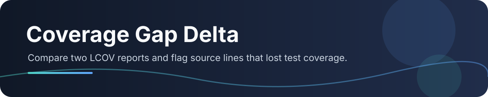

<p align="center"></p>

# Coverage Gap Delta ✨

> Compare two LCOV reports and flag source lines that lost test coverage.

[](https://github.com/MofidChallenge10/coverage-gap-delta/actions/workflows/ci.yml) [](LICENSE) 

## 🎯 Why this project?

Compare two LCOV reports and flag source lines that lost test coverage. It focuses on a narrow operational problem and keeps its output inspectable, deterministic, and suitable for scripts or CI.

## 🚀 Features

- 🧭 Solves the documented use case without a hosted service.
- 🧪 Includes repeatable tests and a runnable example.
- 📄 Supports concise human-readable output; machine-readable output is available where documented.
- 🔒 Avoids changing the target system during inspection.

## ⚡ Quick Start

```bash
node bin/coverage-gap-delta.js examples/baseline.info examples/current.info --fail-on-regression
```

## 🖥️ Example

```text
Coverage regressions: 1
src/parser.js:42  covered → uncovered
Newly uncovered lines: 1
```

## 🗺️ Roadmap

- Add Cobertura XML input after defining equivalent line semantics.
- Add GitHub Actions annotations for changed source lines.
- Add branch coverage comparison when both reports include it.

## 🤝 Contributing

See [CONTRIBUTING.md](CONTRIBUTING.md). Bug reports should include the command, a minimal input fixture, and the observed output. Please do not attach credentials or private production data.

## 📜 License

MIT — see [LICENSE](LICENSE).
